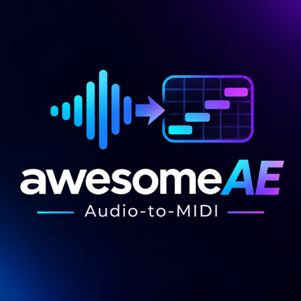
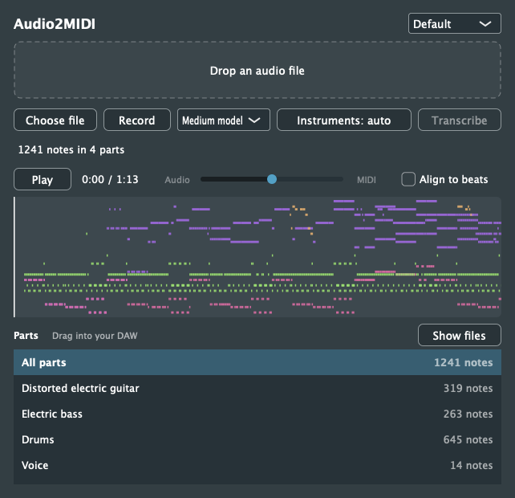

<p align="center"></p>

# Audio2MIDI

**A free, local, open-source alternative to Mirelo Audio-to-MIDI.** No subscription, no transcription credits, your audio stays on your machine. A free Hugging Face account is required for the initial model download.

Audio-to-MIDI plugin (VST3, AU, Standalone). Put it on an audio track, drop in a file or record the track, check the result in the piano roll and by ear, and drag the transcribed MIDI parts back into your DAW. Full mixes work: you get one MIDI file per instrument plus one with every part.

Transcription runs locally with [MuScriptor](https://github.com/muscriptor/muscriptor) by Kyutai and Mirelo. This project is not affiliated with either.

<p align="center"></p>

## Audio2MIDI vs. Mirelo

**Transcribe on your own computer, without paying per song or buying credits.**

| | Audio2MIDI (this project) | Mirelo Audio-to-MIDI plugin |
| --- | --- | --- |
| Cost | **Free download and local transcription**; no subscription or credits | Free download; transcription uses account credits |
| Usage allowance | **No credit balance or monthly quota**; limited by your hardware | 2.5 credits per audio second; free plan includes 5,000 credits/month (about 33 minutes) |
| Processing | **Local**, on your computer | Cloud, on Mirelo's servers |
| Audio upload | **No audio sent to a cloud service** | Audio uploaded for transcription |
| Internet | Initial dependency and model downloads; transcription runs locally afterward | Required for transcription |
| Account | No Audio2MIDI account; free Hugging Face account for model access | Mirelo account required |
| Plugin source | **Open source**, AGPL-3.0 | Separate commercial product; Mirelo also co-released the open MuScriptor research model |
| DAW workflow | File drop or recording; full mixes; per-instrument and combined MIDI export | File drop or recording; full mixes; per-instrument and combined MIDI export |
| Transcription model | Open MuScriptor research model | Audio-to-MIDI Pro production model |

Free does not mean unrestricted: MuScriptor's weights are **CC BY-NC 4.0 (non-commercial)**. You supply the hardware, disk space and electricity. This project does not claim the same transcription accuracy as Mirelo's production model. See [Requirements](#requirements) and [Limits](#limits) before installing, including the untested Windows support.

Comparison checked November 9, 2026 against Mirelo's [plugin announcement and FAQ](https://mirelo.ai/blog/audio-to-midi-vst-plugin), [model overview](https://mirelo.ai/models/audio-to-midi), and the [MuScriptor model card and licence](https://huggingface.co/MuScriptor/muscriptor-medium). Mirelo's plans and rates may change.

## How it works

```
DAW ── Audio2MIDI plugin (JUCE, C++) ──HTTP──▶ MuScriptor engine (Python, PyTorch) on 127.0.0.1:8722
```

The model is a PyTorch transformer, so the plugin does not embed it. It starts the engine itself on the first transcription (`uv` installs a pinned `muscriptor==0.4.0` in an isolated Python 3.12 environment) and stops it when the last plugin instance closes. The engine also exits on its own if the DAW crashes. An engine that is already running on port 8722 is reused. Switching the model size restarts an engine the plugin started, once no transcription is running; an engine started by another program keeps the model it has.

## Requirements

- macOS 11+ (Apple Silicon or Intel) or Windows 10+ x64
- [uv](https://docs.astral.sh/uv/getting-started/installation/)
- A free Hugging Face account. The model weights are gated under CC BY-NC 4.0:
  1. Accept the licence at [MuScriptor/muscriptor-medium](https://huggingface.co/MuScriptor/muscriptor-medium), and at [muscriptor-small](https://huggingface.co/MuScriptor/muscriptor-small) or [muscriptor-large](https://huggingface.co/MuScriptor/muscriptor-large) to use those sizes.
  2. Run `uvx hf auth login` once.
- About 2 GB of disk space for PyTorch and the medium weights, which download on the first run. The small model adds about 0.4 GB, the large one about 5.5 GB.

## Install (macOS)

1. Download `Audio2MIDI-macOS.pkg` from the [latest release](../../releases/latest) (Universal, macOS 11+).
2. Open it. The installer is not notarized, so macOS blocks it the first time: open **System Settings → Privacy & Security** and click **Open Anyway**.
3. Install. It puts the VST3 and AU into `~/Library/Audio/Plug-Ins` and needs no administrator password.
4. Restart or rescan your DAW. In Ableton Live, check that **Settings → Plug-Ins → Use VST3 Plug-In System Folders** is on.

`Audio2MIDI-macOS.zip` holds the same plugins for manual copying. Files copied from it keep the download quarantine; clear it with `xattr -dr com.apple.quarantine <plugin>`.

## Build

```bash
cmake -S . -B build -G Ninja -DCMAKE_BUILD_TYPE=Release
cmake --build build
```

JUCE 9.0.5 is fetched by CMake. The VST3 and AU are copied to `~/Library/Audio/Plug-Ins` after building. Rescan plugins in your DAW.

## Use

1. Insert **Audio2MIDI** on an audio track.
2. Drop an audio file (wav, aiff, flac, mp3, ogg) on the plugin, use **Choose file**, or press **Record** and play the track.
3. Optional: limit **Instruments** to the parts you expect. The default detects them automatically.
   Pick the **model** size: **Medium** is the default, **Small** is faster, **Large** is more accurate but slower and needs more memory. Each size downloads its weights on first use.
4. Press **Transcribe**. The first run takes a few minutes while the engine and weights download.
5. Select a part and press **Play** to hear it. The preview plays through the track: the slider mixes the original audio with the MIDI, played by macOS's built-in General MIDI sounds. Click the piano roll to jump. Some DAWs, such as Logic Pro, only run a track's plugins while the transport plays; the plugin tells you when that is the case.
6. Turn on **Align to beats** to snap every note to the detected beat grid. Leave it off to keep the performance as played.
7. Drag **All parts** or a single instrument into your DAW. **Show files** opens the MIDI files.

The MIDI files carry the detected tempo and meter, so they land on the grid. The result is saved with your project and comes back when you reopen it.

## Test

```bash
ctest --test-dir build                                    # unit tests
build/Audio2MidiTests_artefacts/Release/Audio2MidiTests --e2e song.mp3 [--model small] [drums electric_bass]
pluginval --strictness-level 10 --validate ~/Library/Audio/Plug-Ins/VST3/Audio2MIDI.vst3
packaging/macos/build-pkg.sh build/Audio2Midi_artefacts/Release 0.3.0 Audio2MIDI-macOS.pkg
```

`--e2e` runs a real transcription through the same engine code the plugin uses. It starts and stops the engine when none is running.

## Limits

- No AAX, so no Pro Tools.
- Windows builds from source but is untested. The engine runs PyTorch on the CPU there, the MIDI preview is silent, and the engine outlives a crashed DAW.
- Release binaries are not signed or notarized.
- Recordings stay in a temporary folder. The transcription is saved with the project, a recorded take is not.

## License

The plugin source is [AGPL-3.0](LICENSE), as required by JUCE's open-source licence. The MuScriptor model weights are CC BY-NC 4.0 and are downloaded at runtime, never bundled.
